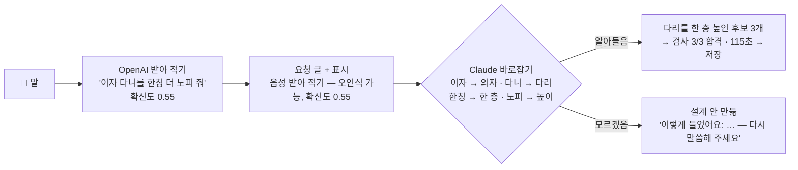
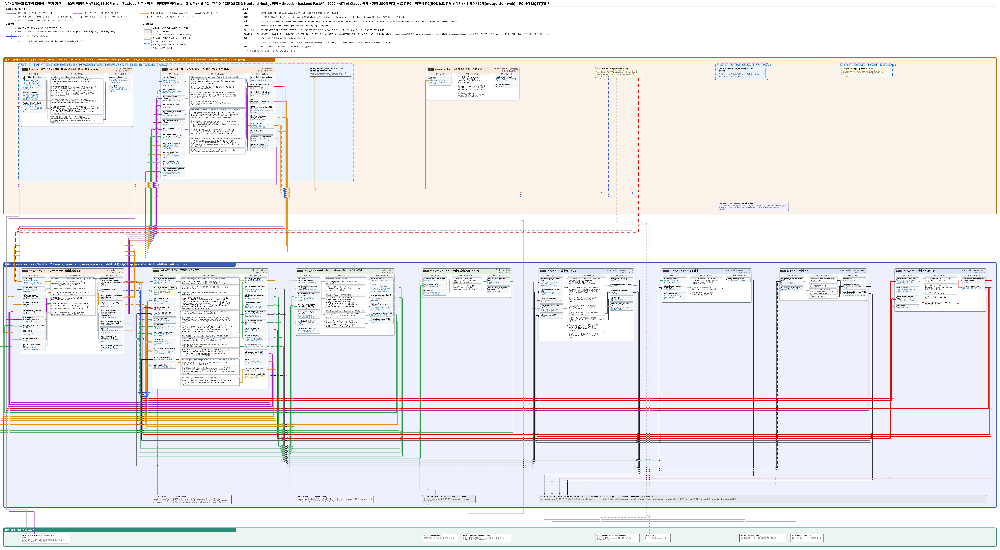
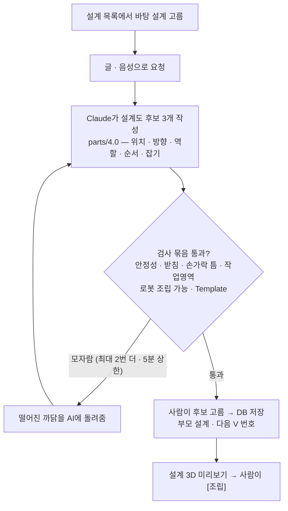
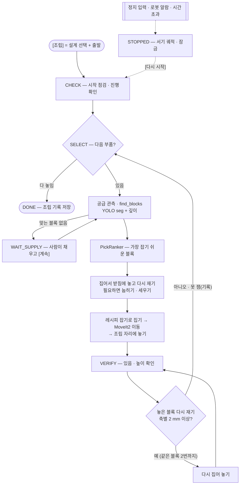
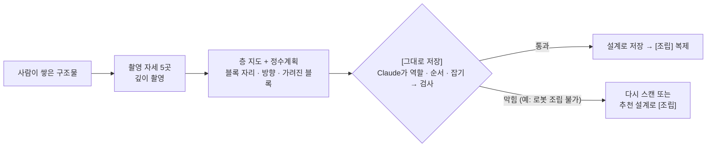

# 🧱 BuildMind — 말하면 AI가 설계하고, 협동로봇이 조립한다

<p align="center">
  
  
  
  
  
  
  
  
  
  
  
</p>

글이나 말로 원하는 가구를 요청하면 **Claude가 젠가 블록 설계도를 쓰고**, 검사를 통과한 설계를 **두산 M0609 협동로봇이 흩어진 블록을 찾아 MoveIt2로 조립**합니다. 사람이 쌓은 구조물은 **스캔해 설계도로 복원하고 그대로 복제**합니다.

> 두산 로보틱스 ROKEY Boot Camp 9기 · 협동-2 **D2팀(5명)** — 한석형 · 황인재(PL) · 민범진 · 박진용 · 한세교 · 2026.10.01 ~ 10.16(16일)

## 🎬 데모

### ▶ 1분 시연 영상

https://github.com/user-attachments/assets/b2ba76bf-ef47-488e-af1e-1aae9185de38

<details>
<summary><b>장면별 영상 5개</b> — 소개 · DEMO 1 AI 설계 → 로봇 조립 · DEMO 2 스캔 복제 · 핵심 기술 · 검사 · 정지 · DB · 결과</summary>

**① 소개 · 작업 환경 · 시스템 구조** (0:30)

https://github.com/user-attachments/assets/863609a7-cb46-4749-a29f-8f62bd5ed3aa

**② DEMO 1 — 말로 설계하고, 로봇이 조립한다** (1:35) — "다리 두 층 낮춰줘" → Claude 설계 → 검사 통과 후보 3개 → 흩어진 블록 찾기 → 받침 경유 → MoveIt2 이동 → 놓고 확인 → 완성

https://github.com/user-attachments/assets/ff01e06d-94be-4cde-8aa0-d5699410675d

**③ DEMO 2 — 보고, 복원하고, 그대로 복제한다** (1:15) — 5자세 깊이 촬영 → 층 지도 + 정수계획 복원 → [그대로 저장] → 세우기 포함 복제

https://github.com/user-attachments/assets/7aa25b1a-8102-4e07-91b6-e3d15155035f

**④ 핵심 기술 — 정확하게 집고, 세우고, 바로잡는다** (1:20) — 기울여 잡기 · 받침에서 눕히기 · 높게 · 옆으로 세우기 · 다시 집기 · 놓은 블록 다시 재기 · 가상 모드 검증

https://github.com/user-attachments/assets/9defcd46-ab43-4950-9152-f3d299f1bf48

**⑤ 못 짓는 설계는 막고, 언제든 멈춘다** (1:01) — 로봇 조립 가능 검사 · 정지 · 설계 DB 세대 관리 · 결과

https://github.com/user-attachments/assets/f2660d87-2b99-4d77-a181-26144f963ae2

</details>

## 💡 한눈에

| 문제 | 우리 방법 |
|---|---|
| 모양이 바뀌면 설계 · 검토 · 교시를 사람이 다시 한다 | 말하면 AI가 블록마다 위치 · 방향 · 잡기 · 순서까지 쓴 설계도를 만든다 |
| 설계 → 검사 → 이력 → 조립이 끊겨 있다 | 규칙 검사를 통과한 설계만 DB에 버전으로 저장하고, 조립 결과를 다음 생성에 참고한다(RAG) |
| 이미 있는 실물에는 설계도가 없다 | 깊이 카메라로 스캔해 블록 단위 설계도로 복원하고 복제한다 |

모델을 따로 학습시키지 않고 **규칙 + 프롬프트**로, 맞물림 없는 젠가 블록과 팔 하나로 풀었습니다. 검사를 통과한 설계만, **사람이 [조립]을 눌러야** 로봇이 움직입니다.

```text
요청(글 · 🎤) → Claude 설계 후보 3개 → 검사 8단계 → DB 저장 → [조립] → 블록 찾기 · 우선순위로 고르기 · 집기 · 세우기 → MoveIt2로 놓기 → 다시 재기
스캔(5자세) → 층 지도 + 정수계획 → 설계도 복원 → 검사 · 저장 → 복제 조립
```

## ✨ 핵심 기능

### 🎙️ 음성 요청 — OpenAI 받아 적기 + Claude 바로잡기
"hello rokey" → 말 → **OpenAI가 받아 적은 글을 확신도와 함께** 넘기면, **Claude가 설계를 만드는 같은 호출 안에서 비슷한 소리로 바로잡아** 읽습니다. '정지'라고 말하면 로봇이 멈춥니다(보조 정지).



<details>
<summary>자세히</summary>

- **흐름:** 화면 🎤 버튼 → 시동어 **"hello rokey"**(openWakeWord · 강의 제공 모델) → 높은 '삑' → 말 → 말이 0.8초 끊기면 녹음 끝(Silero VAD, 최대 7초) → 낮은 '삑' → 받아 적기(OpenAI `gpt-4o-mini-transcribe`, 실패하면 `whisper-1`) → 받아 적은 문장이 글 창에 들어가 **바로 생성**합니다.
- **Claude 바로잡기:** 받아 적기는 틀린 낱말이 섞일 수 있습니다. 그래서 받아 적은 글에 **확신도(OpenAI logprobs 평균)** 를 붙여 `[음성 받아 적기 — 오인식 가능, 확신도 n]`으로 표시하고, Claude가 설계를 만드는 **같은 호출 안에서** 소리가 비슷한 가구 · 부품 · 크기 말로 바로잡아 읽게 했습니다(AI를 한 번 더 부르지 않음). 확신도가 낮을수록 더 넓게 바로잡고, 그래도 뜻을 모르면 설계를 만들지 않고 "이렇게 들었어요: … — 다시 말씀해 주세요"로 답합니다.
- **한국어 · 잡음 처리:** 한국어 지정 + 가구 낱말 힌트를 줍니다. 말소리가 0.3초보다 짧으면 받아 적기를 부르지 않고, 무음에서 STT가 지어내는 자막식 문장('시청해 주셔서 감사합니다' 같은)과 힌트를 되읽은 글은 버립니다.
- **말로 정지:** '정지 · 멈춰 · 스톱 · 그만'으로만 된 말은 받아 적자마자 MQTT `d2/safety/stop/req` → 다리 → 정지 노드 잠금으로 갑니다. '그만큼 높게' 같은 요청은 정지로 보지 않습니다. 말로 정지는 **보조 정지**이고, 진짜 정지는 펜던트 · 화면 [정지] · Ctrl+C입니다.
- **안전:** 음성으로는 설계 고르기 · 조립 출발을 하지 않습니다. 로봇은 사람이 [조립]을 눌러야만 움직입니다.

</details>

### 🧠 AI 설계 생성 · 검사
Claude가 고른 설계를 바탕으로 블록마다 **위치 · 방향 · 잡기 · 순서**를 쓴 후보 3개를 만들고(JSON Schema 구조화 출력 — 형식 실패 0), 무게중심 · 받침 · 손가락 틈 · **로봇 조립 가능** 등 8단계 검사를 통과한 것만 남깁니다.

<table>
  <tr>
    <td width="50%" align="center"><br><sub>"다리 두 층 낮춰줘" → 후보 3개 → 3D 미리보기</sub></td>
    <td width="50%" align="center"><br><sub>로봇이 지을 수 없는 설계는 막음</sub></td>
  </tr>
</table>

<details>
<summary>자세히</summary>

- **생성:** 웹 PC에 로그인된 Claude Code를 호스트 중계(`claude_bridge`)로 부릅니다(API 키 없음). 고른 설계와 같은 Template의 다른 설계를 참고해, 부품마다 **위치 · 방향 · 역할 · 그룹 · 순서 · 단계 · 잡기**를 쓴 설계도 후보 3개(`parts/4.0`)를 만듭니다. **JSON Schema 구조화 출력**이라 형식 실패가 0입니다.
- **검사 8단계:** 무게중심 여유 ≥ 7 mm(쌓는 도중 포함) · 받침 · 손가락 틈 · 작업영역 · Template 범위 + **로봇 조립 가능 검사** — 어떤 순서로든 그리퍼로 지을 수 있는지 봅니다(한 층 1.5초 상한). 떨어지면 까닭을 AI에 돌려줘 최대 2번 더 만듭니다.
- 통과한 설계만 레시피 파일(`_recipe.json` + `_placements.csv`)이 되고, 사람이 3D 미리보기를 보고 **[조립]** 을 눌러야 로봇이 움직입니다.

</details>

### 🗂️ 설계 DB 세대 관리 (PLM + RAG)


PostgreSQL에 기본 설계 4개와 AI가 만든 설계를 **부모 설계와 이어 버전으로** 저장하고(만든 방법 · 조립 결과 함께), 생성 때 같은 Template 설계를 AI가 골라 참고합니다(RAG).

<details>
<summary>자세히</summary>

- PostgreSQL 16 표 3개(`designs` 설계 · `builds` 조립 기록 · `gen_logs` AI 호출)에 기본 설계 4개(벤치 · 등받이 의자 · 세운 다리 책상 · 가운데 기둥 책상, `_V000`)와 생성본(`_V001`, `_V002` …)을 **부모 설계와 이어서** 저장합니다. 만든 방법(CAD · 글 · 음성 · 스캔) · 조립 결과(성공 · 오차 · 시간)가 함께 남고, 화면에서 버전 트리로 봅니다.
- 생성 때 AI가 같은 Template의 설계 요약을 보고 도구(`get_design`)로 최대 2개를 골라 읽습니다(RAG).

</details>

<br clear="right">

### 🎯 블록 집기 우선순위 알고리즘 (PickRanker)
섞여 쌓인 블록에서 **무엇을, 어떤 순서로 집을지** 정합니다. 블록마다 YOLO seg 윤곽 + 깊이로 자세 · 방향 · 덮임 · 기울기를 계산하고, 손가락 두 자리를 깊이로 미리 봐서 막힌 후보를 뺀 뒤 **눕힌 블록 → 선 블록 → 큰 옮김, 묶음 안에서는 높은 층부터** 줄 세웁니다. 막히면 다음 후보로 넘어갑니다.

<table>
  <tr>
    <td width="50%" align="center"><br><sub>블록마다 번호 = 집는 순서 · ① 먼저 집을 블록</sub></td>
    <td width="50%" align="center"><br><sub>순위대로 가장 잡기 쉬운 블록부터 집기</sub></td>
  </tr>
</table>

<details>
<summary>자세히</summary>

**고르는 규칙**
1. 묶음: ① 눕힌 블록 → ② 옆으로 선 · 선 블록 → ③ 큰 옮김(잡을 블록이 하나도 없을 때만)
2. 묶음 안에서는 **높은 층부터** — 기울어진 블록은 반올림한 층이 아니라 실제 높이로 따짐
3. 같은 높이에서는 덮은 블록 치우기 → 눕힘 곧게 → 눕힘 틀기 → 기울여 집기 → 옆으로 선 · 선 → 큰 옮김
4. 줄 세우기 전에 모든 후보의 손가락 두 자리를 깊이로 보고 막힌 후보를 뺌 — 위에서 본 사각형 검사만으로는 곧게 37번 중 19번 · 틀기 25번 중 21번이 고른 뒤 깊이에서 걸려 헛시도가 쌓였음

**처음(BlockPicker) → 지금(PickRanker)**

| | 처음 | 지금 |
|---|---|---|
| 집는 자세 | 레시피 자세만 | 모든 자세 — 선 · 옆세움은 받침에서 눕힘 |
| 기운 · 덮인 블록 | 뺌 → 사람 호출 | 기울여 집기 · 위 블록부터 치움 |
| 손가락 자리 | 비전 틈 ≥ 22.2 mm | 깊이 높이 지도로 직접 봄 |
| 순서 | 틈 넓은 것 → 높은 것 | 눕힌 블록 먼저 → 높은 층 → 곧게 · 틀기 · 기울여 집기 |
| 후보 | 블록 하나 | 줄 세운 목록 — 막히면 다음 |
| 화면 표시 | 없음 | 손목 그림에 순위 ①② · 고른 블록 칠하기 · ① 까닭 한 줄 |

**결과:** 같은 실기 배치 152번에 넣어 비교한 계산에서 사람 호출 **10 → 4** · 1순위가 큰 옮김인 경우 **8 → 0**. 실기(가운데 기둥 책상) 블록 11/11 · 집기 **24/24** · 헛시도 **0** · 사람 호출 **0**.

</details>

### 🤖 받침 경유 · 세우기 · 다시 집기
고른 블록은 받침에 한 번 내려놓고 다시 재어 곧게 집거나 세웁니다. 기울어진 블록은 기울여 잡아 눕히고, 놓은 블록은 다시 재서 **2 mm 넘게 어긋나면 다시 집어** 놓습니다.

<table>
  <tr>
    <td width="33%" align="center"><br><sub>받침 경유 — 틀어진 블록도 다시 재서 집음</sub></td>
    <td width="33%" align="center"><br><sub>높게 · 옆으로 세우기</sub></td>
    <td width="33%" align="center"><br><sub>기울여 잡기 · 눕히기</sub></td>
  </tr>
</table>
<table>
  <tr>
    <td width="50%" align="center"><br><sub>위치를 바꿔도 다시 찾아 집음</sub></td>
    <td width="50%" align="center"><br><sub>dy +3.7 mm → 다시 집기 → +0.5 mm</sub></td>
  </tr>
</table>

<details>
<summary>자세히</summary>

- 공급 영역에 흩뿌린 블록을 손목 카메라 D435i로 찍어 **YOLO seg(직접 학습한 모델) 윤곽 + 깊이**로 자세 · 방향 · 손가락 틈 · 겹침 · 기울기를 판정하고, **PickRanker**가 높은 층 · 잡기 쉬운 블록부터 고릅니다.
- 집은 블록은 받침에 한 번 놓고 다시 재어 곧게 다시 집습니다(**받침 경유**). 세울 블록은 받침에서 세우고(`STANDUP_HIGH` · `STANDUP_SIDE`), 기울어진 블록은 기울여 잡아 눕힙니다.
- 블록을 놓을 때마다 있음 · 없음 + 높이를 확인하고, 방금 놓은 블록을 **YOLO 마스크 + 카메라 광선**으로 다시 잽니다. 축별 2 mm 이상 어긋나면 같은 블록을 최대 2번 다시 집어 놓습니다. 못 재면 까닭만 기록하고 다음 블록으로 갑니다.
- `FLAT_SHORT`로 놓는 블록은 놓기 위치를 긴 축으로 +2.4 mm 보정합니다(`robot.yaml` 한 곳에서 관리).

</details>

### 🦾 MoveIt2 동작 계획 · 안전 정지
모든 팔 동작을 **MoveIt2**로 계획합니다. 놓인 블록 · 받침 · 쥔 블록까지 장면에 넣어 피해 가고, 길을 움직이기 전에 모두 계산합니다. 정지하면 '지금 자리에 서기' 궤적을 제어기에 바로 보냅니다.

<table>
  <tr>
    <td width="33%" align="center"><br><sub>쌓은 블록을 피해 놓기(RViz)</sub></td>
    <td width="33%" align="center"><br><sub>실기 전 가상 모드 검증</sub></td>
    <td width="33%" align="center"><br><sub>"hello rokey" → '정지' · 화면 [정지]</sub></td>
  </tr>
</table>

<details>
<summary>자세히</summary>

- 집기 · 옮기기 · 놓기 · 관측 · 스캔 촬영 자세까지 **모든 팔 동작을 MoveIt2(`move_group`)로 계획**합니다 — OMPL BiTRRT(안 풀리면 RRTConnect) · IK KDL.
- **장면(Planning Scene)** 에 작업대 · 받침 상자 · 놓은 블록을 넣고, 집은 블록은 그리퍼에 붙여 쥔 채로 피해 갑니다. 놓인 블록은 계획 때만 20 mm → 10 mm → 0 순서로 부풀려 여유를 두고, 6구간 길을 움직이기 전에 모두 계산해 실패는 출발 전에 거릅니다.
- 정지 · 시간 초과 때는 진행 중 목표를 취소하고, 정지 노드가 '지금 자리에 서기' 궤적을 제어기에 직접 보냅니다.

</details>

### 🔍 스캔 복제
5곳에서 깊이 촬영 → **층 지도 + 정수계획**으로 가려진 블록까지 복원 → 검사 · 저장 → 로봇이 같은 자리에 복제합니다.

<table>
  <tr>
    <td width="50%" align="center"><br><sub>깊이 촬영 → 점군 → 설계 복원</sub></td>
    <td width="50%" align="center"><br><sub>같은 자리 · 방향 · 모양으로 복제</sub></td>
  </tr>
</table>

<details>
<summary>자세히</summary>

- 사람이 쌓은 구조물을 촬영 자세 5곳에서 깊이 촬영 → **층 지도 + 정수계획(SciPy milp)** 으로 블록 자리 · 방향 · 가려진 블록까지 복원합니다(젠가 블록 크기가 하나라 15 · 25 · 75 mm 격자에 맞출 수 있음). 스캔 중에는 점군 미리보기를 1.5 Hz로 화면에 띄웁니다.
- [그대로 저장] → Claude가 역할 · 순서 · 잡기를 채움 → 검사 → 설계로 저장 → 사람이 치우면 로봇이 같은 자리에 복제합니다. 저장이 검사에 막히면 저장된 설계 중 **추천 설계(일치율 상위)** 로 바로 조립합니다.

</details>

## 🛠️ 시스템 구조

**PC 2대** — 로봇 PC에는 ROS 2 노드가 모두 있고, 웹 PC에는 ROS가 없습니다. 둘은 **MQTT 다리(`d2_bridge`)** 한 곳으로만 이어집니다.

<p align="center">
  <br>
  <sub>시스템 아키텍처 v7 — 노드 카드마다 입력 → 처리 → 출력, 화살표 색 = 데이터 갈래 · 따라 읽는 법: <a href="docs/guides/시스템아키텍처_설명_v4_101608.md">시스템 아키텍처 설명</a></sub>
</p>

| 브라우저에서 바로 보기 | 무엇이 보이나 |
|---|---|
| <a href="https://viewer.diagrams.net/?lightbox=1&nav=1#Uhttps%3A%2F%2Fraw.githubusercontent.com%2Frokey9-d2%2Frokey_9_pjt2_D2%2Fmain%2Fdocs%2Fimages%2F%25EC%258B%259C%25EC%258A%25A4%25ED%2585%259C%25EC%2595%2584%25ED%2582%25A4%25ED%2585%258D%25EC%25B2%2598_v7_101320.drawio"></a> | 전체 그림 확대 · 이동 — 노드 카드 · 토픽 · 서비스 선 · 컨테이너 · MQTT 토픽 표 · ERD |
| <a href="https://htmlpreview.github.io/?https://github.com/rokey9-d2/rokey_9_pjt2_D2/blob/main/docs/images/archify/index.html?v=20261016c#arch"></a> | 탭 4개 — 시스템 아키텍처 · 플로우 차트 · DB ERD · MQTT 토픽 흐름(움직임 · 다크 모드 · 내보내기) |

<details>
<summary>노드 표 · 플로우 차트 · mermaid 흐름</summary>

| 위치 | 노드 · 프로그램 | 하는 일 |
|---|---|---|
| 로봇 PC | `task` | 조립 · 스캔 상태표, 다음 부품 고르기, 검사 묶음(`DesignChecker`), 정지 · 다시 시작 처리 |
| 로봇 PC | `wrist_block` · `scan_live_preview` | 배치 확인 · 흩어진 블록 찾기 · 놓은 블록 재기 · 스캔 촬영 · 추론 / 스캔 중 점군 미리보기 |
| 로봇 PC | `pick_place` · `scene_manager` · `gripper` · `safety_stop` | 집기 · 놓기(MoveIt2) · 장면 · 그리퍼 · 정지(서기 궤적 · 잠금) |
| 로봇 PC | `bridge` | ROS ↔ MQTT 변환(토픽 `d2/…`, 요청 `…/req` · `…/res`) |
| 웹 PC(컨테이너) | `mosquitto` · `db` · `web` | MQTT 브로커 · PostgreSQL · backend(REST · WebSocket · AI 생성 · 저장소) + 화면 |
| 웹 PC(호스트) | `claude_bridge` · `voice.py` | 설계 AI 중계(Claude Code) · 음성(시동어 · 받아 적기 · 말로 정지) |

<p align="center">
  <picture>
    <source media="(prefers-color-scheme: dark)" srcset="docs/images/플로우차트_v1_101610_dark.png">
    
  </picture><br>
  <sub>요청 → AI 생성 → 검사 → 저장 → 로봇 조립 + 옆으로 들어오는 스캔 복제 · 사람 손이 필요한 예외 · 움직이는 그림: <a href="https://htmlpreview.github.io/?https://github.com/rokey9-d2/rokey_9_pjt2_D2/blob/main/docs/images/archify/index.html?v=20261016c#flow">그림 모음 → 플로우 차트</a></sub>
</p>

**① 요청 → AI 설계 생성 → 검사 → 저장**



**② 로봇 조립 (작업 관리자 `task` 상태표)**



**③ 스캔 복제**




이름 · 칸의 정본은 [인터페이스 문서(IRD)](docs/02_인터페이스_IRD_v4_101608.md), 패키지 · 상태표 · 절차는 [설계 문서(SDD)](docs/03_설계_SDD_v4_101608.md)입니다. 좌표 · 그리퍼 값 · 시간 기준은 설정 파일 하나(`src/d2_robot/d2_bringup/config/robot.yaml`)에 둡니다.

</details>

## 🧩 기술적 도전 · 해결

로봇이 계산대로 움직여도 실물은 몇 mm씩 어긋났습니다. **값이 이상하면 기준(높이 · 보정 · 무게)부터 다시 재서** 하나씩 고쳤습니다.

| 문제 | 원인 → 해결 | 결과 |
|---|---|---|
| 놓는 높이가 틀리고, 비스듬히 보면 점이 9 ~ 11 mm 밀림 | 작업대 높이 기준이 **18 mm 낮음**(손끝 길이 착오) → 높이 기준 0 · 원점 다시 교시 · 보정 광축 고침 | 26자세 평균 **2.08 mm** |
| 정지를 눌러도 4.4 ~ 5.0초 더 움직임 | 이미 보낸 궤적이 계속 돌고 ROS가 먼저 꺼짐 → 신호를 직접 받아 '서기' 궤적을 바로 보냄 | 가상 **0.58 ~ 1.12초** · 실기 즉시 정지 |
| 놓은 블록을 깊이만으로 재면 11개 중 3개만 잼 | 블록 가장자리에서 깊이가 번짐 → 윤곽은 YOLO 마스크, 크기 · 위치는 카메라 광선으로 계산 | **11 / 11** · 다시 집기 2.17 → **0.73 mm** |
| 검사기가 한쪽으로 내민 계단을 "안전"으로 판정 | 맞닿은 면만 보고 위 덩어리 쏠림을 못 봄 → 단계마다 위 덩어리 전체 무게중심 계산 | +10.8 mm(통과) → **−2.5 mm(불안정)** |

<details>
<summary>15건 모두 보기 — 로봇 · 정밀도 9건 · 계획 · 비전 · AI · 음성 6건</summary>

**로봇 · 정밀도 — 기준을 다시 재서 고친 것**

| # | 문제 | 원인 | 해결 → 결과 |
|---|---|---|---|
| 1 | 놓는 높이가 틀리고, 손목 카메라로 비스듬히 보면 점이 9 ~ 11 mm 밀림 | 작업대 높이 기준이 **18 mm 낮음** — 손끝 길이를 29 mm로 잘못 봄(실제 약 11 mm) | 작업대 z를 0으로 다시 정하고 조립 원점 다시 교시 · 보정 광축 고침 → 26자세 평균 **2.08 mm** |
| 2 | 손목 카메라가 작업면을 50 mm 높게 봄 | hand-eye 보정의 z 상수 오차 | z +49.4 mm 보정 → 다시 재니 **−0.5 mm** |
| 3 | 손목 카메라 수평 오차 10.7 mm | 한 높이에서만 보정해 수평 · 기울기 오차가 섞임 | 4각도 × 2높이로 다시 보정 → 기울기 1.29° → **0.15°** · 관측 4점 평균 **1.15 mm** |
| 4 | 손목을 90° 돌려 놓은 블록만 약 4 mm 어긋남 | 손가락 가운데가 손목 회전축(TCP)에서 2.7 mm 비켜 있음 | 제어기 TCP와 MoveIt 손끝을 같은 파일 값으로 → 5.9 → **1.46 mm** |
| 5 | 손목(6축)이 궤적 끝에서 31.6° 덜 돎 | 두산 안전 설정이 6축을 30 °/s로 제한하는데 MoveIt은 더 빠르게 계획 | MoveIt 6축 최대 1.0 rad/s(× 0.5 = 28.6 °/s) → **도착 확인 통과** |
| 6 | 정지를 눌러도 4.4 ~ 5.0초 더 움직임 | 이미 보낸 궤적이 계속 돌고, Ctrl+C에 ROS가 먼저 꺼짐 | 신호를 직접 받아 '지금 자리에 서기' 궤적을 제어기에 바로 보냄 → 가상 **0.58 ~ 1.12초** · 실기 즉시 정지 |
| 7 | 이동 중 충돌 오검출로 멈춤 | 충돌 민감도 100 % + 공구 무게 1.47 kg(실제 1.43) | 공구 무게 1.43 kg · 민감도 **75 %** |
| 8 | 블록을 쥔 채 공중에서 섬 | 쥔 블록 상자가 작업대와 겹쳐 들기 계획이 실패 — 잡은 뒤에야 다음 길을 계산 | 바닥이 작업대보다 낮게 나오면 작업대 높이로 올림 + 6구간을 **움직이기 전에 모두 계산** |
| 9 | 받침에서 블록 잡기 실패 | 자로 잰 높이 94 mm를 씀 — 로봇 FK 높이는 93.1 mm | 잡는 높이를 FK 값으로 → 받침 경유 **4/4** |

**계획 · 비전 · AI · 음성 — 원인을 찾아 고친 것**

| # | 문제 | 원인 | 해결 → 결과 |
|---|---|---|---|
| 10 | 공중 이동 중 의자 등받이와 충돌 | 여유 0인 길 + 장면과 실물 차(높이 2.5 mm · 옆 5.1 mm) | 계획 때만 놓인 블록을 20 mm 부풀림(→ 10 → 0 mm) → **충돌 0** |
| 11 | 흩뿌린 더미에서 1순위를 잘못 고름(71장면 중 16) | 점수 하나로 순위를 매김 | 규칙 고침 + 손가락 자리를 먼저 거름 → 큰 옮김 1순위 8 → **0** · 실기 집기 **24/24** |
| 12 | 놓은 블록을 다시 잴 때 높이 쌓을수록 실패(깊이만 쓰면 3/11) | 블록 가장자리에서 깊이가 번져 윗면 끝이 3 ~ 5 mm 처져 보임 → 크기 · 기울기를 잘못 잼 | 윤곽은 컬러 YOLO 마스크로, 크기 · 위치는 마스크 가장자리로 그은 카메라 광선과 윗면 높이가 만나는 점으로 계산 → 74.3 × 25.4 mm(실제 74.5 × 24.8) · 실기 **11/11** |
| 13 | 스캔 추론이 실물 사진에서 무너짐(3/11 · 3/16 · 0/9 · 1/11) | 잡음에 약한 추론 · 3자세로는 가린 칸을 못 봄 | 층 칸 지도 + 정수계획 · 5자세 → **62/65(95 %)** · 추정 블록 13 → 0 |
| 14 | 검사기가 한쪽으로 내민 계단을 "안전"으로 판정 | 위에 얹힌 무게를 맞닿은 면 가운데에만 걸어 계산 — 위 덩어리 전체의 쏠림을 못 봄 | 쌓는 단계마다 위 덩어리 전체 무게중심이 받침 안쪽 7 mm 이상인지 계산 → 20 mm씩 3번 내민 계단: +10.8 mm(통과) → **−2.5 mm(불안정)** |
| 15 | 음성이 무음에서 문장을 지어냄(2/10) · '정지' 5/10 | 계속 듣고 받아 적어 무음 · 잡음도 문장으로 만듦 | 버튼 + 시동어 · 말소리만 녹음 · 지어낸 자막 버림 · 한국어 지정 → 무음 5번 · 잡음 6건 **생성 0** |

</details>

## 📊 결과

<p align="center">
  
  
  
  
  
</p>

| 지표 | 결과 |
|---|---|
| 흩어진 블록 집기 | **98 %**(159 / 162, 통합 시험 4판 합) · 10/15 통합 테스트 **35 / 35** |
| AI 설계 생성 | 검사 합격 **4 / 5** · 형식 실패 **0** · 통과 평균 **103초** · AI가 만든 설계 **2종 실제 조립** |
| 스캔 복원 일치율 | **92 %**(12 / 13, 통합 시험) · **95 %**(62 / 65, 사진 판정) |
| 집기 우선순위 | 사람 호출 **10 → 4**(같은 배치 152번 계산) · 실기 집기 **24 / 24** · 헛시도 **0** |
| 놓기 정밀도 | 다시 집기로 **2.17 → 0.73 mm** · 높이 오차 최대 **1.8 mm**(벤치) |
| 음성 | 시동어 **5 / 5** · 무음에서 잘못 생성 **0 / 5** · 말로 정지 **2 / 2** |
| 자동 시험 | **2,251개** 통과 — CI가 PR마다 |

<details>
<summary>기능별 실기 결과 · 통합 시험 정량 측정 전체 보기</summary>

**기능별 실기 결과** — 기능마다 실기에서 잰 값

| | 지표 | 결과 | 목표 | 무엇을 잰 값인가 |
|---|---|---|---|---|
| 🧱 | 자동 조립 완성 | **11 / 11 블록** | 벤치 11개 · 3번 중 2번 | 화면에서 고른 설계를 끝까지 쌓음 — 벤치 실기 4번 이상(10/6 ~ 10/15) |
| 🤖 | 흩어진 블록 집기 | **35 / 35 (100 %)** | 10개 중 8개 | 10/15 통합 테스트 집기 · 놓기 시도 35번 실패 0 · 10/13 정식 흐름 35 / 37 · 36 / 37 |
| 🧠 | AI 설계 검사 합격 | **변형 요청 4 / 5** · 형식 실패 **0** | 요청 3개 중 2개 통과 | 10/15 리허설 — 1개는 '범위 밖' 안내(대안 제시) · 10/14 후보 6 / 6(글 165초 · 음성 115초) |
| ⏱️ | AI 설계 생성 시간 | 통과 평균 **103초**(44 ~ 151초) | (제안) 60초 이하 | 10/15 리허설 AI 호출 기록 — 목표에 못 미침 |
| 🏗️ | AI가 만든 설계 실제 조립 | **2종 완성** | 2종 | 음성으로 만든 `003_DESK_STAND_V002` · `004_DESK_PEDESTAL_V001` |
| 🎙️ | 음성 | 시동어 **5 / 5** · 무음 5번 생성 **0** · 말로 정지 **2 / 2** · 오인식 바로잡기 후보 **3 / 3** 합격 | 무음 5번 → 생성 안 함 | 10/15 실기 · 10/14 확신도 0.55 음성 요청(115초) |
| 🔍 | 스캔 복원 일치율 | **100 %** · **95 %**(65개 중 62) | 90 % 이상 | 사람이 쌓은 벤치 실기(10/13) · 기본 설계 사진 판정 |
| 📏 | 놓은 블록 다시 집기 | 어긋남 **2.17 → 0.73 mm** | ±2 mm | 놓은 블록을 다시 재서 2 mm 넘으면 다시 집어 놓음(10/14) |
| 👁️ | YOLO seg(직접 학습) | mAP50 **0.972** · mAP50-95 **0.831** | — | yolo26s-seg · 150 epoch · 사진 208장 · 모델 5종 비교 |
| 🗂️ | 설계 세대 관리(DB) | 파생 설계 **15개** · **3세대** | 부모 · 버전 트리 | PostgreSQL `designs`(10/15 조회) |
| ⏱️ | 블록 1개 조립 시간 | 약 **80초** | (제안) 60초 이하 | 받침 경유 · 다시 재기 포함 — 벤치 11개 14분 36초(10/15) |
| ✅ | 자동 시험 | **2,251개** 통과 | — | `src/d2_task/test` 1,442 · `tests/` 503 · `src/d2_vision/test` 306 — CI가 PR마다 |

**통합 시험 정량 측정** — 10/15 통합 시험 · 리허설 6판(끝까지 4판 · 정지 2판)을 같은 측정표로 잰 값

| 지표 | 결과 | 목표 | 판정 |
|---|---|---|---|
| 흩어진 블록 집기 | **98 %**(159 / 162, 4판 합) | ≥ 80 % | ✅ 통과 |
| 스캔 일치율 | **92 %**(12 / 13) · 추론 22.5초 | ≥ 90 % | ✅ 통과 |
| 시동어 인식 · 무음에서 잘못 생성 | **5 / 5** · **0 / 5** | 무음 → 생성 안 함 | ✅ 통과 |
| 정지 → 다시 시작 · 말로 정지 | **2 / 2** · **2 / 2** | — | ✅ 통과 |
| 기록 누락 | **0** | 0 | ✅ 통과 |
| 수평 오차 2 mm 안 | **10 / 11**(최대 2.7 mm, 마스크로 잼 · 자 확인 전) | ≤ 2 mm | ⚠️ 거의 |
| 높이 오차 최대 | 벤치 **1.8 mm** · 책상 **4.0 mm** | ≤ 2 mm | ⚠️ 책상 판 넘음 |
| 블록당 시간 | **75 ~ 80초**(벤치 · 의자 1개 약 14분) | ≤ 60초 | ❌ 못 미침 |
| AI 설계 생성 시간 | **103초**(통과 4개 평균 · 44 ~ 151초) | ≤ 60초 | ❌ 못 미침 |

보호 정지는 6판 중 1번(책상 판) 있었습니다.

자세한 근거는 [결과표](docs/04_결과_결과표_v2_101608.md)와 [시험 보고](docs/test-reports/)에 있습니다.

</details>

## 🌱 배운 점 · 한계

**배운 점**

- 값이 이상하면 코드보다 **기준(높이 · 보정 · 무게)부터** 다시 잽니다. 놓는 높이 · 손목 카메라 · 받침 잡기 오차는 모두 기준값을 다시 재서 풀렸습니다.
- **멈춤은 로봇 쪽 한 곳에서** 처리해야 합니다. 정지 노드가 '지금 자리에 서기' 궤적을 제어기에 직접 보내게 하자 바로 섰습니다.
- **반영 순서도 코드만큼 중요합니다.** 10/14 통합 시험은 코드가 main에 다 있는데도 PC에 반영하는 순서(화면 다시 빌드 → web 다시 켜기 → 로봇 PC 빌드)가 빠져 옛 화면 · 설정이 돌아 막혔고, 그 뒤 PC별 반영 순서를 명령으로 정해 지켰습니다.
- 로봇이 계산대로 움직여도 실물은 몇 mm씩 어긋나, 오차를 하나씩 찾아 줄이는 일이 가장 어려웠습니다.

**한계와 다음 과제**

- 블록당 **75 ~ 80초**(목표 60초) · AI 설계 생성 통과 평균 **103초**(목표 60초)로 시간 목표에 못 미쳤습니다.
- 높이 오차가 책상 판에서 최대 **4.0 mm**, 수평 오차가 최대 **2.7 mm**로 2 mm 목표를 넘은 곳이 있고, 통합 시험 6판 중 보호 정지가 1번(책상 판) 있었습니다.
- 계획했던 **사람과 번갈아 쌓는 협동 모드**는 구현하지 못했습니다.
- 다음 과제: 큰 설계(2인용 등)의 조립 중 공급 채우기 · 사이클 시간 줄이기 / 협동 모드를 위한 사람 손 인식 · 공간 지도 / dy 오차 원인 찾기 / 로봇 오차를 흡수하려 둔 받침을 없애고 관측 동작 줄이기

## 👥 팀 · 역할

| 파트 | 담당 | 맡은 것 |
|---|---|---|
| 로봇 동작 | 박진용 · 한세교 | 로봇 셀 · MoveIt2 집기 · 놓기 · 정지 · 장면 · 세우기 · CAD · 레시피 · 변환기 |
| 비전 | 민범진 · 한석형 · 황인재 | 손목 보정 · 블록 인식(YOLO seg) · 배치 확인 · 흩어진 블록 찾기 · 고르기 · 작업 관리자 · 검사 묶음 · 스캔 추론기 |
| 음성 | 민범진 | 시동어 · 녹음 · 받아 적기 · 말로 정지 |
| HMI | 황인재(PL) | 웹 화면 · AI 설계 생성 · DB · MQTT 다리 · 웹 PC compose · 통합 · 일정 · 발표 |

## 🤝 개발 · 협업 방식

16일 동안 **PR 183개 · 커밋 606개 · 결정 기록 123건 · 자동 시험 2,251개**. PR마다 자동 검사 + Claude 검토 → 승인 → auto-merge, 기능 동결 뒤에는 PL 통합 브랜치로만 main에 넣었습니다.

<details>
<summary>일정 · PR 흐름 · 문서 · AI 에이전트 활용</summary>

| 기간 | 단계 | 한 일 |
|---|---|---|
| 10/1 ~ 10/4 | 사전 기획 | 주제 확정(10/3) · 사전 검증 20건 · 시나리오 · 역할 · 인터페이스 회의 |
| 10/6 | 주제 개편 | 피드백(단순 Pick & Place를 넘어서기) → 주제 개편 · PC 배치 · MQTT · CI |
| 10/6 ~ 10/7 | 1차 구현 | 벤치 11개 자동 조립 11/11 · 정지 실기 · 두산 안전 설정 |
| 10/8 ~ 10/13 | 핵심 구현 | AI 설계 · 검사 · DB · 스캔 · 흩어진 블록 · 받침 경유 · 세우기 · 화면 · 음성 |
| 10/13 ~ 10/14 | 통합 · 동결 | 이름 · 데이터 통일 · PL 통합 1 ~ 8차 · **기능 동결(10/14 18시)** |
| 10/15 ~ 10/16 | 리허설 · 시연 | PL 통합 9 ~ 10차 · 튜닝 · 리허설 2번 · 시연 · 발표 |

<p align="center">
  
  
  
  
  
</p>

- **PR 흐름:** 브랜치 → PR(양식의 '변경 파일' 칸) → **PR 검사**(main 반영 · 충돌 · 문법 · 키 유출 · 변경 파일 · 문서 이름 · 정지 설정) + **Claude 검토**(읽기 도구만) → 승인 → **auto-merge(squash)**. CI는 pytest 3곳 + ruff · ROS 2 Jazzy colcon 빌드이고, 필수 검사 3개를 통과해야 들어갑니다.
- **동결 뒤:** 기능 동결(10/14 18시) 뒤에는 draft PR → PL 통합 브랜치(1 ~ 10차) → 통합 테스트 → main 순서로만 넣었습니다.
- **문서:** 정본 01 요구사항 · 02 인터페이스 · 03 설계 · 04 결과 · 05 작업 분류 · 06 협업 규칙과 **결정 기록 E-01 ~ E-123**(뒤 번호가 앞 번호를 바꿈)을 두고, 파일 이름은 `이름_v<버전>_<MMDDHH>` 규칙으로 맞췄습니다.
- **AI 에이전트와 함께:** 팀원마다 자기 Claude Code 에이전트로 개발했습니다. 에이전트가 만든 코드도 사람이 PR로 올리고 검사 · 검토를 거칩니다. PL 공지는 노션으로 나누고, 문서 · 일정 초안은 PL의 문서 담당 에이전트가 씁니다.

자세한 규칙은 [팀 협업 규칙](docs/06_팀협업규칙_v1_101608.md) · [.github/CONTRIBUTING.md](.github/CONTRIBUTING.md), 날마다 바뀐 것은 [CHANGES.md](CHANGES.md)에 있습니다.

</details>

## 💻 개발 환경 · 장비

<details>
<summary>OS · 미들웨어 · 모션 · 비전 · AI · 웹 · 장비 표</summary>

- **OS:** Ubuntu 24.04 LTS (로봇 PC · 웹 PC)
- **Middleware:** ROS 2 Jazzy · CycloneDDS(로봇 PC 안, `ROS_DOMAIN_ID` 60) · MQTT Mosquitto 2(PC 사이)
- **Motion:** MoveIt2(OMPL BiTRRT → RRTConnect) · 두산 `doosan-robot2`(Jazzy) · OnRobot RG2 드라이버
- **Vision:** Intel RealSense · Ultralytics YOLO seg(직접 학습한 `block_seg_26s_e150_261008.pt`) · OpenCV · NumPy · SciPy
- **AI · 음성:** Claude(Claude Code `claude -p` — 웹 PC 호스트 중계) · OpenAI `gpt-4o-mini-transcribe`(→ `whisper-1`) · openWakeWord · Silero VAD
- **Web · DB:** FastAPI · paho-mqtt · psycopg 3 · PostgreSQL 16 · Next.js 16 · React 19 · three.js
- **Language · Infra:** Python 3.12 · TypeScript · Docker compose(컨테이너 3개) · GitHub Actions CI

| 장비 | 모델 · 사양 | 용도 |
|---|---|---|
| 협동로봇 | Doosan M0609(6축 · 가반 6 kg · 도달 900 mm) | 집기 · 옮기기 · 놓기 · 스캔 촬영 자세 |
| 그리퍼 | OnRobot RG2(0 ~ 110 mm · 잡는 힘 10 N) | 블록 잡기 · 폭으로 잡힘 확인 |
| 손목 카메라 | Intel RealSense D435i(컬러 + 깊이 640 × 480) | 흩어진 블록 찾기 · 배치 확인 · 놓은 블록 재기 · 스캔 |
| 마이크 · 스피커 | 웹 PC에 연결 | 시동어 · 음성 요청 · 말로 정지 |
| 블록 | 표준 젠가 75 × 25 × 15 mm · 1세트 54개 | 기본 설계 9 ~ 16개 + 공급 |
| PC | 노트북 2대 — 로봇 PC(ROS 2) · 웹 PC(Docker, ROS 없음) | 둘 사이는 Wi-Fi MQTT |

</details>

## 🚀 설치 · 실행

<details>
<summary>의존성 설치 · 웹 PC · 로봇 PC 실행 순서 · 화면에서 조립</summary>

### 📦 의존성 설치

#### 1. Python 필수 라이브러리 (`requirements.txt`)

```bash
# 로봇 PC — ROS 2 노드가 쓰는 pip 꾸러미(YOLO · 스캔 추론기 · 다리)
pip install -r requirements.txt
# 웹 PC 음성(호스트) — 가상 환경 하나에
pip install sounddevice openwakeword openai paho-mqtt "numpy<2"
```

웹 PC backend 꾸러미(`web/backend/requirements.txt`)는 `web` 컨테이너 이미지가 깝니다. 자동 시험 꾸러미는 `tests/requirements.txt`입니다.

#### 2. ROS 2 패키지 (로봇 PC)

```bash
sudo apt update
sudo apt install ros-jazzy-desktop ros-jazzy-moveit ros-jazzy-realsense2-camera ros-jazzy-rmw-cyclonedds-cpp python3-paho-mqtt
# 두산 드라이버(doosan-robot2, Jazzy) · 브링업 바탕(m0609_rg2_integration) · OnRobot RG2 드라이버는 교육 과정 배포본 — 저장소 밖에서 colcon build
cd <이 저장소> && colcon build --symlink-install && source install/setup.bash
```

판(커밋)과 환경 변수(`RMW_IMPLEMENTATION=rmw_cyclonedds_cpp` · `ROS_DOMAIN_ID=60`)는 [환경 문서](docs/env/README.md)를 따릅니다.

#### 3. 웹 PC

```bash
sudo apt install docker.io docker-compose-v2 libportaudio2
# 화면 빌드용 Node 24(nvm) · Claude Code 설치 후 이 PC에서 로그인(설계 AI — 키 없음)
cd web && cp .env.example .env    # OpenAI 키(음성 받아 적기) · DB 비밀번호는 .env 에만 — 커밋하지 않음
```

---

### 🚀 실행 순서

전체 시스템은 아래 순서대로 터미널을 열어 실행합니다. **켜는 순서: 웹 PC(브로커 · DB · 웹 → 설계 AI 중계 → 음성) → 로봇 PC(브링업 → 손목 카메라 → 노드 4개 → 손목 비전 → 작업 관리자 → MQTT 다리)** — 다리가 붙을 브로커가 먼저 떠 있어야 하고, 노드 4개는 브링업 로그에 `You can start planning now!`가 나온 뒤에 켭니다. 로봇을 움직이기 전에 **펜던트를 든 사람이 옆에 있고, 사람이 작업 영역 밖인지** 확인합니다.

#### 1. 웹 PC — 화면 · 브로커 · DB · 설계 AI · 음성

```bash
# 터미널 1 — 화면 빌드(처음 · 화면이 바뀐 때) → 방화벽(브로커는 로봇 PC만) → 컨테이너 3개
(cd web/frontend && npm ci && npm run build)
mkdir -p web/backend/data
sudo bash tools/install_mqtt_access.sh <로봇 PC IP> <웹 PC IP>
D2_WEB_IPV4=<웹 PC IP> WEB_UID=$(id -u) WEB_GID=$(id -g) docker compose -f web/compose.yaml up -d

# 터미널 2 — 설계 AI 중계(점검 → 실행)
python3 web/claude_bridge.py --check --host 172.17.0.1
python3 web/claude_bridge.py --host 172.17.0.1

# 터미널 3 — 음성(점검 → 실행) — 의존성 설치 1에서 음성 꾸러미를 깐 가상 환경의 python 으로
<가상환경>/bin/python web/backend/voice.py --check --host <웹 PC IP>
<가상환경>/bin/python web/backend/voice.py --host <웹 PC IP>
```

화면은 웹 PC 브라우저에서 `http://127.0.0.1:8000`을 엽니다(다른 PC에서는 안 열림 — 보안).

#### 2. 로봇 PC — 브링업 · 카메라 · 노드

```bash
# 모든 터미널: 환경 변수(로봇 PC .bashrc 에 넣어 둠) + source
export RMW_IMPLEMENTATION=rmw_cyclonedds_cpp ROS_DOMAIN_ID=60
source /opt/ros/jazzy/setup.bash && source <두산 워크스페이스>/install/setup.bash && source install/setup.bash
# 터미널 1 — 브링업(두산 드라이버 · MoveIt2 · 그리퍼 드라이버)
ros2 launch d2_bringup real_moveit.launch.py mode:=real host:=192.168.1.100
# 터미널 2 — 손목 카메라(정렬 깊이 · 640×480 — YOLO 를 이 크기로 학습)
ros2 launch realsense2_camera rs_launch.py align_depth.enable:=true rgb_camera.color_profile:=640x480x30 depth_module.depth_profile:=640x480x30
# 터미널 3 — 정지 노드 · 그리퍼 · 장면 · 집기 놓기(노드 4개)
ros2 launch d2_bringup robot_nodes.launch.py mode:=real
# 터미널 4 · 5 · 6 — 손목 비전 · 작업 관리자 · MQTT 다리
ros2 run d2_vision wrist_block
ros2 run d2_task task
ros2 run d2_bridge bridge --ros-args -p mqtt_host:=<웹 PC IP>
# (선택) 터미널 7 — 스캔 중 점군 미리보기
ros2 run d2_vision scan_live_preview
```

#### 3. 화면에서 조립 · 스캔

1. 화면 위 연결 줄에서 웹 서버 · 브로커 · 로봇 PC 연결이 모두 정상인지 봅니다.
2. 설계 목록에서 설계를 고르고 → (원하면) [AI 생성] → 설계 3D에서 **[조립]**.
3. 스캔 복제는 구조물을 두고 **[스캔]** → 스캔 칸에서 [그대로 저장] 또는 추천 설계 [조립].
4. 멈추면 [다시 시작] 또는 [초기화] → [정리 끝] — 자세한 것은 [복구 절차](docs/ops/복구절차_정지뒤다시시작_v1_101608.md).

로봇 없이 돌려 보기(개발 PC)는 `ros2 run d2_bridge mock_bridge` · `ros2 run d2_vision mock_wrist_block` · `python3 web/backend/mock_robot.py` — [설계 문서](docs/03_설계_SDD_v4_101608.md) 3.5. main을 받은 뒤 PC별 반영(웹 PC `restart web` · 로봇 PC 바뀐 패키지 빌드)은 [web/README](web/README.md) · [src/README](src/README.md).

</details>

## 📁 문서

| 경로 | 내용 |
|---|---|
| [`src/`](src/README.md) | ROS 2 패키지 — `d2_interfaces` · `d2_robot/` · `d2_vision` · `d2_task` · `d2_bridge` · `recipe_manager` |
| [`web/`](web/README.md) | 웹 PC — `backend/`(FastAPI · AI 생성 · 저장소 · 음성) · `frontend/`(Next.js + three.js) · `claude_bridge.py` · `compose.yaml` |
| [`docs/`](docs/README.md) | 정본 01 ~ 06 · `decisions/`(결정 기록) · `guides/` · `ops/` · `test-reports/` · `env/` · `images/` |
| [`tests/`](tests/README.md) | ROS 없는 자동 시험(pytest) — CI가 PR마다 돈다 |

<details>
<summary>폴더 구조</summary>

```text
rokey_9_pjt2_D2/
├── src/                          # ROS 2 패키지 (로봇 PC)
│   ├── d2_interfaces/            #   전용 메시지 7개 + JsonQuery
│   ├── d2_robot/
│   │   ├── d2_bringup/           #   브링업 launch · robot.yaml(설정 한 곳) · 기본 설계 레시피
│   │   ├── d2_motion/            #   pick_place(집기 · 놓기 + MoveIt2 실행기) · scene_manager(장면)
│   │   ├── d2_gripper/           #   RG2 그리퍼 노드
│   │   └── d2_safety/            #   정지 노드(서기 궤적 · 잠금)
│   ├── d2_vision/                #   wrist_block(YOLO seg · 배치 확인 · 스캔 추론) · scan_live_preview · models/*.pt
│   ├── d2_task/                  #   task(작업 관리자 · 작업 판단 · 검사 묶음 · 조립 가능 검사)
│   ├── d2_bridge/                #   ROS ↔ MQTT 다리
│   └── recipe_manager/           #   CAD → 레시피 도구(cads · recipes)
├── web/                          # 웹 PC (ROS 없음)
│   ├── backend/                  #   FastAPI · AI 설계 생성 · 저장소(PostgreSQL / JSON) · voice.py(음성)
│   ├── frontend/                 #   Next.js + three.js 화면
│   ├── db/  · mosquitto/         #   PostgreSQL 표 · MQTT 브로커 설정
│   ├── claude_bridge.py          #   설계 AI 중계(웹 PC 호스트)
│   └── compose.yaml · Dockerfile #   컨테이너 3개(mosquitto · db · web)
├── docs/                         # 문서 — 01 ~ 06 정본 · decisions · guides · ops · test-reports · env · images
├── tests/                        # ROS 없는 자동 시험(pytest)
├── tools/                        # 문서 이름 도구 · 웹 PC 브로커 방화벽 · 포트 확인
├── .github/                      # PR 양식 · PR 검사 · CI · Claude 검토
├── requirements.txt              # 로봇 PC pip 꾸러미
└── README.md
```

</details>

## 라이선스

[Apache License 2.0](LICENSE). 두산 · OnRobot 드라이버(저장소 밖)는 각 제공자의 라이선스를 따릅니다.
